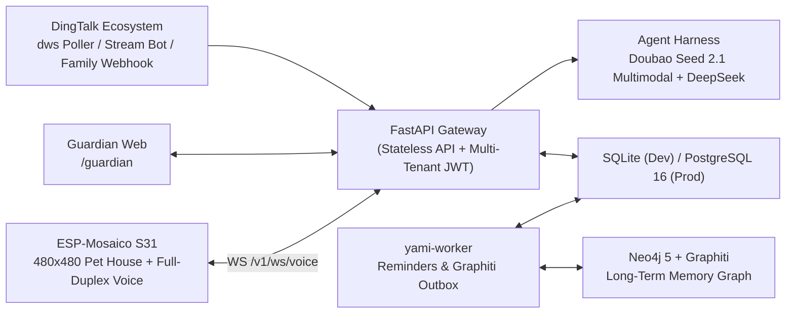

# Yami Learning Companion (芽米学习伙伴)

**English** | [简体中文](./README_CN.md)

> **Open-source hardware + AI learning companion for elementary school families**: connects **School DingTalk Notices & Homework → Guardian Web Dashboard → ESP-Mosaico S31 Full-Duplex Voice Desk Companion & 480×480 Virtual Pet House**.

---

## Key Features

- **Guardian Web Workspace (3-Column Morning Porcelain UI)**:
  - **Today (`今日`)**: Daily Homework (1-click complete & DingTalk sync), Parent Todos (signed school notices & submissions), Review & Preview, Custom Tasks with full lifecycle (`daily / weekdays / once`, pause/resume, streaks), and Today's Teacher Feedback.
  - **Growth (`成长`)**: Monthly Growth Calendar (with today highlight), Teacher Praise & Classroom Performance Board (with manual logging & subject stats), Authoritative Textbook Catalog Mastery, Auto-Aggregated Habit Stats, Non-Intrusive Emotion Barometer, Transparent Learning Memory, and Timezone-Aware Daily Voice Conversation Logs.
  - **Skills (`技能`)**: Per-student Skill lifecycle control (enable/pause 5 AI skills independently).
  - **Settings (`设置`)**: Multi-child profiles & textbook versions, 6-digit ESP-Mosaico device pairing, DingTalk integration, and 1:1 Polaroid Pet House sync.
- **Zero-Forwarding DingTalk Sync + Multimodal Agent**:
  - Official `dws` CLI poller automatically pulls school work notices & class group messages without adding bots to school groups;
  - Outbound DingTalk **Stream Mode** bot (no public domain or ngrok required) with **Doubao Seed 2.1 Multimodal Vision** to OCR blackboard homework photos & school notice screenshots, backed by cross-source semantic deduplication;
  - Isolated Family Private Webhook alerts so school class groups are never disturbed.
- **ESP-Mosaico S31 Desk Hardware Companion**:
  - Dual-core full-duplex `esp-skainet` AFE (AEC + NS + VAD) with zero-dependency RFC 6455 WebSocket streaming voice & instant Barge-In interruption;
  - 480×480 AMOLED *Yami Pet House* with 9 animated frame-by-frame pets, learning coin rewards, 7-day unattended runaway & 100-coin warm recall;
  - 6-digit pairing code + NVS token persistence for multi-tenant family isolation.

---

## Architecture



---

## Quick Start (Windows / Linux / macOS — Zero Docker)

### Option A: Zero-Command Share via Git Repo URL (AI Agents / Local One-Liner)

- **Easiest (Just paste the Git repo URL to any AI Agent)**: In **Antigravity / Codex / WorkBuddy / Claude Code / Cursor**, paste this repository URL and say *"Clone and run local demo"*. The agent reads [AGENTS.md](./AGENTS.md) and automatically runs `python yami.py demo` on **Windows, Linux, or macOS** (zero Docker, zero Bash).
- **Direct Local One-Liner (Windows / Linux / macOS, Python 3.9+)**:

```bash
git clone https://github.com/ThinkMo/yami-companion.git && cd yami-companion && python yami.py demo
```

> Opens Guardian Web at **http://127.0.0.1:8000/guardian** in under a minute.
> For daily use with your own `.env` keys (without demo data): `python yami.py setup` → edit `.env` → `python yami.py start` (Press `Ctrl+C` to stop all services cleanly).

### Option B: Full Local Setup with Docker (PostgreSQL 16 + Neo4j 5, macOS/Linux)

```bash
# Optional production-like storage stack
./scripts/setup.sh --docker
./scripts/yami_up.sh start   # Launches API (:8000), Worker, DingTalk Stream Bot, and dws Poller
./scripts/yami_up.sh status
```

---

## DingTalk Integration (No Public Domain Needed)

1. **Stream Mode Bot (DM Blackboard Photos / `@Bot` Commands)**:
   - Create an internal DingTalk app, enable Bot capability, and select **Stream Mode** for message delivery;
   - Enter `ClientId (AppKey)` and `ClientSecret` in **Guardian Web → Settings → DingTalk Integration** (or `.env`), then run `./scripts/yami_up.sh restart`.
2. **Family Private Webhook Alerts**:
   - In your private family group (never in a school group), add a Custom Webhook Bot with keyword `芽米`, paste the Webhook URL into Guardian Web Settings, and click **Test Alert**.
3. **Zero-Forwarding School Notice Auto-Sync (`dws` CLI)**:
   - Install the official [dingtalk-workspace-cli](https://github.com/DingTalk-Real-AI/dingtalk-workspace-cli) and run `dws auth login`;
   - Copy the target conversation's `openConversationId` (`cid...`) into **Guardian Web → Settings → DingTalk Integration → Class Group ID** (comma-separated for multiple conversations), then click **Sync DingTalk Now** or let `yami-dws-poller` poll every 2 minutes automatically.

---

## Building & Flashing ESP-Mosaico S31 Firmware

### Prerequisites
- Hardware: **ESP-Mosaico S31** board + USB-C data cable
- Toolchain: [ESP-IDF v5.3+](https://docs.espressif.com/projects/esp-idf/en/latest/esp32s3/get-started/) (auto-detected from `$IDF_PATH` or `~/esp/esp-idf`)
- Ensure your host machine and ESP-Mosaico are on the **same Wi-Fi LAN** (`yami_up.sh` binds `0.0.0.0:8000` by default)

### One-Command Build & Flash

```bash
# Auto-detects host LAN IP & USB serial port, compiles, and flashes ESP-Mosaico
./scripts/flash_mosaico.sh

# Or specify backend URL, serial port, and open serial monitor:
./scripts/flash_mosaico.sh --backend http://192.168.1.100:8000 --port /dev/cu.usbmodem1101 --monitor

# Compile only (without board attached):
./scripts/flash_mosaico.sh --build-only
```

### First-Time Device Pairing
1. Power on ESP-Mosaico after flashing — a **6-digit pairing code** appears on screen;
2. Open Guardian Web → click **Account (`家长账号`)** in the top-right to register/sign in → go to **Settings → Mosaico Device Pairing** and enter the 6-digit code;
3. Device credentials persist in NVS flash across reboots.

---

## Pre-Publish Security Checklist

Before pushing to a public repository, verify that these local files remain ignored by `.gitignore`:
- `.env` (LLM, TTS, and DingTalk credentials)
- `yami_dev.db` (local family SQLite database)
- `.dws_synced_ids.json` (local DingTalk sync cursor)
- `.yami_run/` (local service PIDs and logs)

---

## License

[MIT License](./LICENSE)
