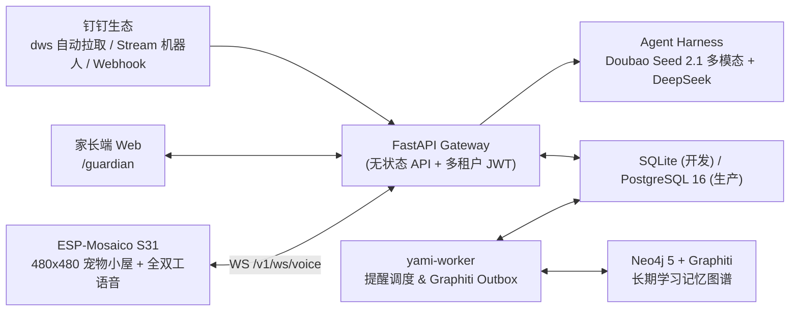

# 芽米学习伙伴（Yami Learning Companion）

[English](./README.md) | **简体中文**

> **软硬一体开源小学生 AI 学习陪伴伙伴**：打通 **学校钉钉通知/作业 → 家长端 Web 统筹 → ESP-Mosaico S31 桌宠全双工语音陪伴与 480×480 宠物小屋激励**。

---

## 核心特性

- **家长端 Web（晨光白瓷三栏工作台）**：`今日`（作业 / 待办 / 预习与复习 / 自定义任务生命周期 / 教师今日反馈）、`成长`（成长日历 / 教师表扬与课堂表现看板 / 真实国家教材目录学情 / 习惯养成自动统计 / 情绪晴雨表 / 按本地时区过滤语音对话）、`技能`（按孩子独立启停 5 大 AI Skill）、`设置`（多孩档案 / Mosaico 配对 / 钉钉集成 / 芽米宠物小屋）。
- **钉钉全自动零转发同步 + 多模态识别**：
  - 支持官方 `dws` CLI 自动拉取学校工作通知与班级群消息（无需加机器人进学校群）；
  - 支持钉钉 **Stream 模式**长连接机器人（免公网域名、免内网穿透），直接转发黑板作业照或通知截图，由 `Doubao Seed` 多模态 Agent 自动拆解入库并语义去重；
  - 支持家庭私群 Webhook 提醒，绝不打扰学校班级群。
- **ESP-Mosaico S31 桌面硬件伴学**：
  - 基于 `esp-skainet` 双核全双工 AFE（AEC 回声消除 + VAD）与原生 RFC 6455 WebSocket 流式语音（支持随时打断 Barge-In）；
  - 480×480 AMOLED《芽米宠物小屋》9 只逐帧动态萌宠、完成学习任务赚宠粮币、7 天未照顾离家出走与 100 币温情召回；
  - 6 位配对码 + NVS 令牌持久化，开机即连，支持多租户家庭账号隔离。

---

## 系统架构



---

## 快速开始（Windows / Linux / macOS 极简零 Docker 启动）

### 方式 A：直接发 Git 仓库链接极简体验（AI Agent / 本地一行）

- **最简单（零命令，直接丢 Git 链接给 AI）**：把本仓库 GitHub 链接发给 **Antigravity / Codex / WorkBuddy / Claude Code / Cursor**，说一句 **「帮我拉取这个仓库并在本地启动演示」**——AI 会自动读取根目录 [AGENTS.md](./AGENTS.md)，在 **Windows / Linux / macOS** 全自动完成克隆、装依赖与启动（零 Docker、零 Bash）。
- **本地终端一行命令（Windows / Linux / macOS，仅需 Python 3.9+）**：

```bash
git clone https://github.com/ThinkMo/yami-companion.git && cd yami-companion && python yami.py demo
```

> 1 分钟内启动并在浏览器打开 **http://127.0.0.1:8000/guardian**。
> 日常使用（接入你自己的 `.env` 模型密钥与真实数据）：`python yami.py setup` → 编辑 `.env` → `python yami.py start`（`Ctrl+C` 一键退出所有进程）。

### 方式 B：完整版（Docker PostgreSQL 16 + Neo4j 5，macOS / Linux）

```bash
./scripts/setup.sh --docker
./scripts/yami_up.sh start   # 后台守护启动 API、Worker、钉钉 Stream、dws 轮询
./scripts/yami_up.sh status
```

---

## 钉钉接入指南（免公网域名）

1. **Stream 模式机器人（单聊转发黑板照片 / `@芽米` 指令）**：
   - 在钉钉开放平台创建企业内部应用并开启「机器人」能力，**消息接收模式选择 Stream 模式**；
   - 将 `ClientId (AppKey)`、`ClientSecret` 填入家长端 **设置 → 钉钉集成配置**（或 `.env`），重启 `./scripts/yami_up.sh restart` 即可直连。
2. **家庭私群 Webhook 提醒**：
   - 在家庭小群（勿在学校群）添加「自定义 Webhook 机器人」，安全关键词填 `芽米`，复制 Webhook URL 填入家长端「设置」并点击「测试提醒」。
3. **免转发自动拉取学校工作通知（`dws` CLI）**：
   - 安装官方 [dingtalk-workspace-cli](https://github.com/DingTalk-Real-AI/dingtalk-workspace-cli) 并执行 `dws auth login`；
   - 找到目标会话的 `openConversationId`（`cid...`），填入家长端 **设置 → 钉钉集成配置 → 班级群 ID**（多个用逗号分隔），点击 **「立即同步钉钉」** 或由 `yami-dws-poller` 每 2 分钟自动拉取。

---

## ESP-Mosaico S31 本地编译与烧录指南

### 前置条件
- 硬件：ESP-Mosaico S31 开发板 + USB-C 数据线
- 工具链：安装 [ESP-IDF v5.3+](https://docs.espressif.com/projects/esp-idf/zh_CN/latest/esp32s3/get-started/)（默认路径 `~/esp/esp-idf`）
- 确保电脑与 Mosaico 连接在**同一局域网 Wi-Fi**

### 一键编译并烧录

```bash
# 自动识别本机局域网 IP 与 USB 串口，编译并烧录到 ESP-Mosaico
./scripts/flash_mosaico.sh

# 如需手动指定后端地址、串口或烧录后查看串口日志：
./scripts/flash_mosaico.sh --backend http://192.168.1.100:8000 --port /dev/cu.usbmodem1101 --monitor

# 仅验证编译（未插板子）：
./scripts/flash_mosaico.sh --build-only
```

### 设备首次配对
1. 烧录完成后给 Mosaico 上电，屏幕将展示 **6 位数字配对码**；
2. 打开家长端 Web → 右上角 **「家长账号」** 登录/注册 → 进入 **设置 → Mosaico 设备绑定** 输入 6 位配对码即可完成绑定；
3. 绑定令牌自动保存在设备 NVS 分区，断电重启免重配。

---

## 开源发布前安全检查

发布到 GitHub 等公开仓库前，请确认以下本地文件已被 `.gitignore` 忽略且未进入提交历史：
- `.env`（包含 LLM / 腾讯云 / 钉钉密钥）
- `yami_dev.db`（本地家庭数据库）
- `.dws_synced_ids.json`（本地钉钉同步游标）
- `.yami_run/`（本地运行日志与 PID）

---

## License

[MIT License](./LICENSE)
