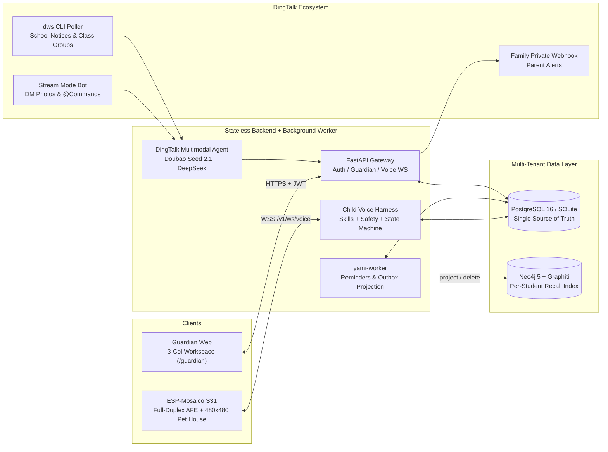

# System Architecture

**English** | [简体中文](./ARCHITECTURE_CN.md)

Yami Learning Companion (`yami-companion`) is a full-stack hardware + AI companion platform built around a **single-source-of-truth relational database**, a **stateless FastAPI gateway**, a **decoupled background worker**, a **Graphiti/Neo4j long-term memory recall index**, and **ESP-Mosaico S31** desk hardware.

---

## 1. High-Level Topology

### Component Boundaries

| Component | Responsibility |
|---|---|
| **FastAPI Gateway** (`backend/api/`) | Multi-tenant PBKDF2 + HS256 JWT auth, 6-digit device pairing, Guardian Web REST APIs, full-duplex `/v1/ws/voice` WebSocket streaming, DingTalk callbacks. 100% stateless across requests. |
| **Child Voice Harness** (`backend/agent/harness.py`) | Orchestrates 5 toggleable per-student Skills (`homework-companion`, `voice-dictation`, `english-speaking`, `pet-companion-house`, `chat-companion`), Socratic step-by-step tutoring, passive non-clinical emotion detection, and Safety Middleware. |
| **DingTalk Multimodal Agent** (`backend/agent/dingtalk_agent.py`) | Routes blackboard photos, school notice screenshots, and natural-language parent messages through **Doubao Seed 2.1 Multimodal** (with **DeepSeek** text fallback) into structured actions (`add_assignment`, `add_todo`, `add_praise`, `start_dictation`, `schedule_reminder`) with cross-source semantic deduplication. |
| **Background Worker** (`backend/worker.py`) | Polls scheduled reminders and drains the `MemoryOutbox` into Neo4j/Graphiti asynchronously so memory indexing never blocks voice latency. |
| **Relational DB** (`PostgreSQL / SQLite`) | Sole authoritative source of truth for families, students, devices, assignments, custom tasks, growth records, pet state, and skill configs. |
| **Graphiti + Neo4j 5** (`backend/memory/`) | Per-student isolated (`graphiti_group_id`) cross-session recall index. Any memory deleted in Guardian Web is immediately purged from both SQL and Graphiti. |
| **ESP-Mosaico S31 Firmware** | Dual-core `esp-skainet` full-duplex AFE (`AFE_TYPE_FD`, AEC + NS + VAD), native RFC 6455 WebSocket client with instant Barge-In (`cancel`), NVS credential persistence, and 480×480 AMOLED Pet House UI. |

---

## 2. LLM Routing, Prompt Caching & Safety Guardrails

- **Converged Model Stack**: **Volcengine Ark Doubao Seed 2.0/2.1** (multimodal vision + low-latency dialogue) + **DeepSeek** (`deepseek-chat` / `deepseek-reasoner` fallback).
- **4-Layer Prompt Cache Structure**:
  1. **Layer 0 (Global Frozen Prefix)**: Yami persona, age-appropriate safety rules, deterministic tool/JSON schemas.
  2. **Layer 1 (Static Curriculum Context)**: Grade-level textbook rules and static problem rubrics (no PII/timestamps).
  3. **Layer 2 (Append-Only Session Turns)**: Multi-turn history within the active tutoring session.
  4. **Layer 3 (Dynamic Suffix)**: Current timestamp, top-3 recalled memory summaries, and the child's latest utterance.
- **Safety Middleware** (`backend/middleware/safety.py`): Stateless input/output guardrails blocking age-inappropriate content and preventing direct final-answer spoilers during Socratic homework help.

---

## 3. DingTalk Zero-Forwarding Sync Architecture

1. **Personal `dws` CLI Auto-Poller** (`backend/adapters/dws_poller.py`): Polls configured DingTalk conversations (school work notices & class groups) via official `dws chat +chat-messages`, deduplicates by `messageId` + semantic similarity, and separates school notices (`家校通知`) into Parent Todos while routing real homework to Today's Assignments.
2. **Outbound Stream Mode Bot** (`backend/adapters/dingtalk_stream.py`): Maintains an outbound WebSocket to DingTalk Open Platform (zero public domain or ngrok needed) supporting text, DM blackboard photos (`picture`), and `richText` messages.
3. **Family Private Webhook** (`backend/reminders/service.py`): Sends quiet-hours-aware Markdown alerts exclusively to the family's private group.

---

## 4. Multi-Tenant Identity & Privacy by Design

- **Family Isolation**: Every Guardian endpoint resolves `family_id` from the signed JWT (`get_current_family_id`), enforcing strict tenant boundaries across students, devices, memories, and conversations.
- **Device Pairing**: Devices generate a 6-digit pairing code (`POST /v1/pairing/issue`), parents claim it in Guardian Web (`POST /v1/auth/devices/claim`), and the device stores its auth token in NVS flash (`401` triggers automatic re-pairing).
- **Transparent Forgetting**: Parents can inspect and delete any stored learning memory or voice conversation history at any time.
