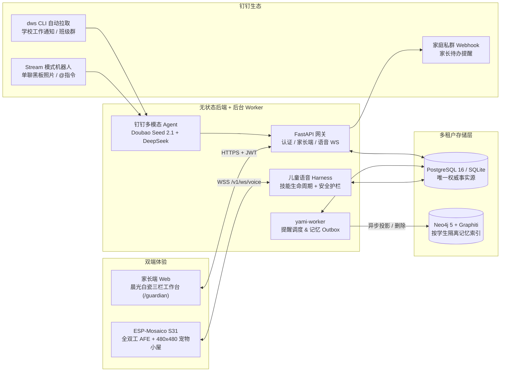

# 系统架构设计

[English](./ARCHITECTURE.md) | **简体中文**

芽米学习伙伴（`yami-companion`）采用 **唯一事实源关系库 + 无状态 FastAPI 网关 + 解耦后台 Worker + Graphiti/Neo4j 记忆索引 + ESP-Mosaico S31 桌宠硬件** 的全栈架构，兼顾本地极简演示（零 Docker / SQLite）与生产级多租户扩展（PostgreSQL 16 + Neo4j 5）。

---

## 1. 系统拓扑全景

### 核心模块边界

| 模块 | 职责与边界 |
|---|---|
| **FastAPI 网关**（`backend/api/`） | PBKDF2 + HS256 JWT 多租户认证、6 位配对码设备认领、家长端 REST 接口、`/v1/ws/voice` 全双工流式语音与钉钉回调。服务完全无状态，可水平扩展。 |
| **儿童语音 Harness**（`backend/agent/harness.py`） | 管理 5 大可按学生独立启停的 Skill（作业陪伴 / 语音听写 / 英语口语 / 宠物小屋 / 日常陪伴），执行苏格拉底分级启发答疑、无感情绪晴雨表检测与安全护栏。 |
| **钉钉多模态 Agent**（`backend/agent/dingtalk_agent.py`） | 将黑板作业照片、学校工作通知截图与家长自然语言统一送入 **Doubao Seed 2.1 多模态**（纯文本支持 **DeepSeek** 兜底），拆解为结构化动作（录作业 / 记待办 / 记老师表扬 / 发听写 / 设提醒），并执行跨来源语义去重。 |
| **后台 Worker**（`backend/worker.py`） | 独立进程运行，负责到点提醒调度与 `MemoryOutbox` 异步写入 Neo4j/Graphiti，绝不阻塞儿童语音首声延迟。 |
| **关系型数据库**（`PostgreSQL / SQLite`） | 家庭、学生、设备、作业、自定义任务、成长记录、宠物状态的**唯一权威事实源**。 |
| **Graphiti + Neo4j 5**（`backend/memory/`） | 按学生 `graphiti_group_id` 严格隔离的跨会话召回索引；家长在 Web 删除任意记忆时，关系库与图谱同步物理移除。 |
| **ESP-Mosaico S31 固件** | `esp-skainet` 双核全双工 AFE（回声消除 AEC + 降噪 NS + VAD）、零依赖 RFC 6455 WebSocket 客户端（支持随时打断 Barge-In）、NVS 令牌持久化与 480×480 宠物小屋 UI。 |

---

## 2. 大模型分工、Prompt Cache 与安全护栏

- **模型收敛**：统一采用 **火山方舟 Doubao Seed 2.0/2.1**（多模态视觉识别 + 低延迟对话）与 **DeepSeek**（`deepseek-chat` / `deepseek-reasoner` 兜底）。
- **四层 Prompt Cache 结构**：
  1. **Layer 0（全局冻结前缀）**：芽米人设、儿童安全规则、确定性排序的工具与 JSON Schema（跨家庭最高命中率）。
  2. **Layer 1（静态教材前缀）**：当前年级教材版本与题目静态规则（不含姓名或时间戳）。
  3. **Layer 2（单会话追加历史）**：当前辅导轮次只追加不回改。
  4. **Layer 3（动态后缀）**：当前时间、本轮召回的最多 3 条记忆摘要与孩子最新一句输入。
- **Safety Middleware**（`backend/middleware/safety.py`）：输入/输出双侧无状态护栏，拦截不适宜内容并禁止在作业启发阶段直接剧透最终答案。

---

## 3. 钉钉免转发同步架构

1. **个人 `dws` CLI 自动拉取器**（`backend/adapters/dws_poller.py`）：通过官方 `dws chat +chat-messages` 定时拉取已配置会话（学校工作通知、班级群），按 `messageId` + 语义相似度双重去重，自动过滤刷卡等无关通知，将「家校通知」送入待办、真实学科练习送入今日作业。
2. **Stream 模式长连接机器人**（`backend/adapters/dingtalk_stream.py`）：本地主动出站连接钉钉开放平台 WebSocket（免公网域名、免内网穿透），支持纯文字、单聊黑板图片（`picture`）与图文混排（`richText`）。
3. **家庭私群 Webhook**（`backend/reminders/service.py`）：仅向家庭私群推送待确认提醒，遵守安静时段策略，绝不打扰学校班级群。

---

## 4. 多租户与隐私设计

- **家庭级隔离**：所有家长端接口均通过 JWT 解析 `family_id`，跨家庭访问自动返回 403。
- **设备配对与持久化**：设备开机生成 6 位配对码 → 家长端绑定 → 设备将凭证写入 NVS 分区（凭证失效返回 401 时自动重新进入配对态）。
- **透明可遗忘**：家长可随时按天查看并清空语音对话记录，或逐条删除芽米记住的长期学习记忆。
